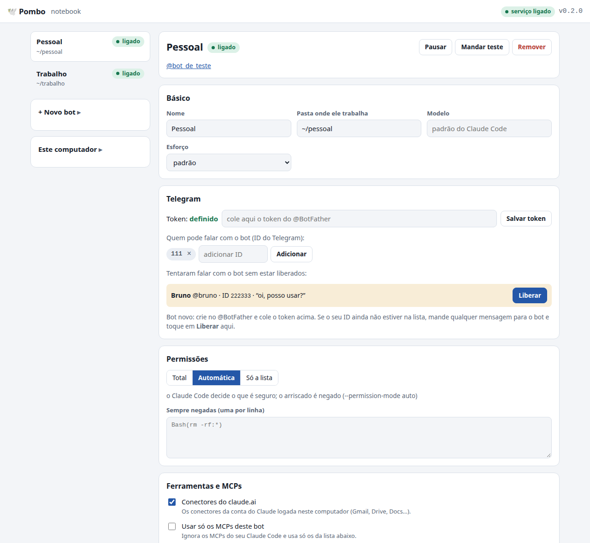
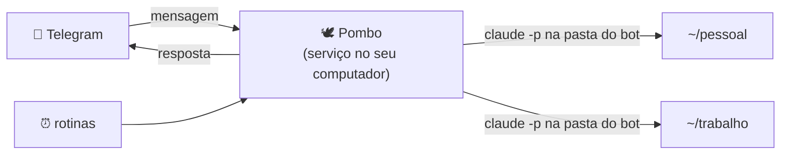
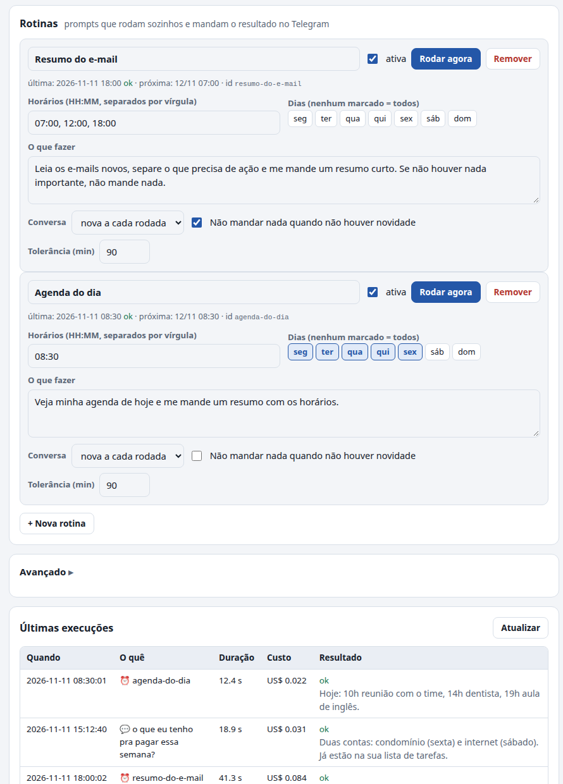

# 🕊️ Pombo

**Um bot do Telegram para cada pasta do seu computador, rodando o Claude Code.**

Você manda uma mensagem pelo celular (texto, áudio, foto ou arquivo). O Pombo leva o recado até o computador, roda
o [Claude Code](https://code.claude.com) dentro da pasta daquele bot e traz a resposta de volta para o chat. Cada bot
também pode ter **rotinas**: tarefas com horário que rodam sozinhas e mandam o resultado (por exemplo, um resumo do
e-mail às 7h, 12h e 18h).

> **English.** Pombo ("pigeon", as in carrier pigeon) turns Telegram into a remote for Claude Code running on your own
> machine: one Telegram bot per folder, persistent conversations, scheduled routines, per-bot permissions and MCP
> servers, a local web panel, and a Claude skill so Claude itself can configure it. Pure Python standard library;
> Linux, macOS and Windows. **The interface (panel, CLI and bot messages) is in Brazilian Portuguese for now.**
> See the [English quick start](#english-quick-start).



## Por que usar

- **Roda no seu computador**, com o Claude Code que você já usa: os seus MCPs, skills, plugins e o seu login.
- **Uma pasta, um bot.** O bot "Pessoal" trabalha em `~/pessoal`, o "Trabalho" em `~/trabalho`, cada um com o
  próprio `CLAUDE.md`, permissões e ferramentas. Um não enxerga as ferramentas do outro.
- **Conversa de verdade.** A conversa continua de uma mensagem para a outra, e responder a uma mensagem antiga
  retoma aquela conversa.
- **Rotinas** com horário, que podem ficar em silêncio quando não há novidade.
- **Configura do jeito que você preferir:** painel web, linha de comando ou pedindo ao próprio Claude.
- **Seguro por padrão:** não abre porta na internet, só responde a quem você liberar, e os tokens ficam fora de
  qualquer arquivo de configuração compartilhável.
- **Sem dependências:** só a biblioteca padrão do Python 3.8+.

## Como funciona



O serviço pergunta ao Telegram, de tempos em tempos, se chegou mensagem (*long polling*), então funciona atrás de
qualquer roteador, sem abrir porta e sem endereço público. Para cada mensagem de alguém liberado, ele roda
`claude -p` na pasta do bot, mostra o andamento ("📖 Lendo notas.md…") e responde.

## Antes de começar

Você precisa de:

1. **Python 3.8 ou mais novo.** Já vem no Mac e no Linux. No Windows, instale pelo [python.org](https://www.python.org).
2. **Claude Code instalado e logado.** Siga [o guia de instalação](https://code.claude.com/docs/en/quickstart), depois
   rode `claude` uma vez no terminal e faça login.
3. **Telegram** no celular.
4. *(Opcional)* **[Tailscale](https://tailscale.com)**, para abrir o painel no celular.

## Instalação

### 1. Baixe o Pombo

```bash
git clone https://github.com/plagesribeiro/pombo.git ~/pombo
cd ~/pombo
```

### 2. Ligue o serviço

```bash
python3 pombo servico instalar
```

Isso deixa o Pombo rodando sozinho e ligando junto com o computador (systemd no Linux, LaunchAgent no Mac, tarefa
agendada no Windows). Também cria o comando `pombo` em `~/.local/bin`, para você não precisar digitar o caminho.
No Windows, use `python pombo ...` no lugar de `pombo ...`.

> **Mac:** o macOS não deixa serviços de fundo entrarem em Documentos, Desktop e Downloads sem autorização. Na
> primeira instalação, abra **Ajustes do Sistema → Privacidade e Segurança → Acesso Total ao Disco**, toque em **+** e
> escolha `~/Applications/Pombo.app`. É uma vez só.

### 3. Ensine o Claude a configurar o Pombo (recomendado)

```bash
pombo skill instalar
```

Isso instala a skill `pombo` no seu Claude Code. A partir daí você pode pedir, em qualquer sessão do Claude (inclusive
dentro dos próprios bots): *"cria uma rotina no bot pessoal todo dia às 8h que me manda a agenda"*.

### 4. Abra o painel

```bash
pombo painel
```

Abra o endereço que ele mostrar (normalmente <http://127.0.0.1:47940>). Em **Este computador**, diga como os bots
devem chamar você.

### 5. Crie o seu primeiro bot no Telegram

1. No Telegram, abra o **[@BotFather](https://t.me/BotFather)** (o bot oficial do Telegram para criar bots).
2. Mande `/newbot`.
3. Escolha um nome de exibição (ex.: *Meu Pombo Pessoal*) e um nome de usuário terminado em `bot`
   (ex.: `meu_pombo_pessoal_bot`).
4. O BotFather responde com um **token**, parecido com `123456789:AAH...`. Copie. **Ele é uma senha:** quem tiver o
   token controla o bot.

### 6. Ligue o bot a uma pasta

No painel, toque em **+ Novo bot**, escreva o nome e a pasta onde ele vai trabalhar (ex.: `~/pessoal`) e toque em
**Criar bot**. Depois, no bloco **Telegram**, cole o token e toque em **Salvar token**. Em poucos segundos o bot
aparece como **ligado**.

Pela linha de comando é a mesma coisa:

```bash
pombo bots criar pessoal --pasta ~/pessoal --nome "Pessoal"
pombo bots token pessoal        # pergunta o token sem mostrar na tela
```

### 7. Libere você

Abra o seu bot no Telegram e mande "oi". Como ninguém foi liberado ainda, ele responde com o seu ID do Telegram, e o
painel mostra você em **"Tentaram falar com o bot"**. Toque em **Liberar**. Pronto: mande "oi" de novo e o Claude
responde.

O Pombo guarda o seu ID, e os próximos bots que você criar já nascem liberados para você.

## Usando pelo Telegram

| Você manda | O que acontece |
|---|---|
| texto | o Claude responde, trabalhando na pasta do bot |
| áudio | transcrito e tratado como texto (precisa configurar a transcrição, veja abaixo) |
| foto ou arquivo | salvo no computador e entregue ao Claude para ler |
| resposta a uma mensagem do bot | continua a conversa daquela mensagem |
| `/novo` | começa uma conversa do zero |
| `/parar` | interrompe o que estiver rodando |
| `/status` | mostra se o bot está ocupado e onde trabalha |
| `/rotinas` e `/rodar N` | lista as rotinas e roda a rotina N agora |

Para receber um arquivo, peça ("me manda o PDF da proposta"). O Claude responde com `ENVIAR_ARQUIVO: /caminho` e o
Pombo manda o arquivo no chat.

A conversa recomeça sozinha depois de 6 horas parada (ajustável). O que o bot deve saber sempre vai no `CLAUDE.md` da
pasta dele, como em qualquer sessão do Claude Code, ou no campo **Instruções** do painel.

### Áudio

O Pombo não transcreve sozinho: ele chama um comando seu. Em **Avançado → Comando de transcrição**, coloque um
comando que receba o arquivo e imprima o texto (ou um JSON com o campo `text`); `{arquivo}` vira o caminho do áudio.
Por exemplo, um script que use o [whisper.cpp](https://github.com/ggerganov/whisper.cpp) ou a API de transcrição que
você preferir:

```json
["python3", "/caminho/transcrever.py", "{arquivo}"]
```

## Rotinas

Uma rotina é um prompt com horário. No painel, em **Rotinas → + Nova rotina**, ou:

```bash
pombo rotinas criar pessoal --nome "Agenda do dia" --horarios 08:30 --dias seg,ter,qua,qui,sex \
  --prompt "Veja minha agenda de hoje e me mande um resumo curto, com horários."
```



- O resultado chega no chat com ⏰ e o nome da rotina. **Responder a ele continua a conversa daquela rodada.**
- **Silenciosa:** se não houver nada de novo, o Claude responde `SEM_NOVIDADE` e nada é enviado. Ótimo para
  "me avise se chegar algo importante".
- **Conversa:** `nova` (cada rodada começa do zero) ou `continuar` (a rodada lembra da anterior).
- **Tolerância:** se o computador estava dormindo no horário, a rotina ainda roda se ele acordar em até 90 minutos
  (ajustável). Depois disso, ela pula aquele horário e avisa no log.
- **Rodar agora:** botão no painel, `/rodar N` no Telegram ou `pombo rotinas rodar pessoal agenda-do-dia`.

## Permissões e segurança

Cada bot tem um modo de permissão:

| Modo | O que faz | Quando usar |
|---|---|---|
| `total` | faz qualquer coisa sem perguntar (`--dangerously-skip-permissions`) | pasta e ferramentas em que você confia totalmente |
| `auto` | o próprio Claude Code decide o que é seguro e nega o arriscado (`--permission-mode auto`) | o meio-termo recomendado |
| `lista` | só as ferramentas que você listar (`--permission-mode dontAsk`) | bots que leem conteúdo de terceiros |

Em qualquer modo, **Sempre negadas** bloqueia o que você quiser (ex.: `Bash(rm -rf:*)`). Quando o Claude tenta algo
bloqueado, o bot avisa no fim da resposta.

**Cuidado com conteúdo de terceiros.** Um bot que lê e-mails, mensagens ou páginas recebe texto escrito por
estranhos, e esse texto pode tentar dar ordens ao Claude (*prompt injection*). O Pombo instrui o Claude a tratar esse
conteúdo como informação, nunca como ordem, e a só enviar e-mails ou mensagens com a sua ordem explícita. Mesmo
assim, para bots desse tipo prefira `auto` ou `lista`.

O que o Pombo faz para te proteger:

- Só responde a IDs liberados; quem não está na lista é ignorado (e aparece no painel).
- Não abre nenhuma porta: o painel só aceita conexões da própria máquina, confere o endereço de quem chama e exige
  um cabeçalho próprio em qualquer mudança.
- Os tokens ficam em `segredos.json` (só o seu usuário lê) ou no Keychain do Mac, nunca nos arquivos dos bots, no
  log, no painel ou no chat.

## Ferramentas, MCPs e contas por bot

Por padrão, cada bot enxerga as mesmas ferramentas do seu Claude Code. No painel, em **Ferramentas e MCPs**, dá para:

- **desligar os conectores do claude.ai** (Gmail, Drive…) naquele bot;
- **acrescentar MCPs só daquele bot** (mesmo formato do `.mcp.json`), e até **usar só esses**;
- **carregar plugins só daquele bot** (skills que só fazem sentido no Telegram);
- ver **quais MCPs ele enxerga** (botão que roda `claude mcp list` na pasta do bot).

Para separar contas de verdade (por exemplo, pessoal e trabalho), use **Avançado → Variáveis de ambiente**. Com
`{"CLAUDE_CONFIG_DIR": "~/.claude-trabalho"}`, o bot usa outro login do Claude Code, com outros MCPs e conectores.
Faça o login dessa conta uma vez com `CLAUDE_CONFIG_DIR=~/.claude-trabalho claude`.

## Vários bots, vários computadores

- Crie quantos bots quiser no mesmo computador: um processo só cuida de todos.
- **Cada token só pode rodar em um computador.** Se dois computadores lerem o mesmo bot, o Telegram reclama (erro
  409). Para ter bots no notebook e num servidor, crie um bot no @BotFather para cada máquina.
- O computador precisa estar ligado e acordado para responder. Mensagens enviadas com ele dormindo ficam guardadas no
  Telegram por 24 horas e são respondidas quando ele voltar.

## Painel no celular

Com o [Tailscale](https://tailscale.com) instalado no computador e no celular:

```bash
pombo servico publicar      # https://<seu-computador>.<sua-tailnet>.ts.net:10004
pombo servico despublicar   # desfaz
```

O endereço só funciona nos aparelhos da sua tailnet.

## Linha de comando

```text
pombo status                          como está cada bot
pombo painel                          endereço do painel
pombo bots                            lista os bots
pombo bots criar ID --pasta P         cria um bot
pombo bots token ID                   grava o token (pergunta sem mostrar)
pombo bots liberar ID USUARIO         libera um ID do Telegram (--tirar para remover)
pombo bots ver ID                     configuração em JSON (sem token)
pombo bots editar ID campo=valor      muda qualquer campo (valores em JSON: true, 10, ["a","b"])
pombo bots pausar|ligar|remover ID
pombo rotinas ID                      lista as rotinas
pombo rotinas criar ID --nome N --horarios 07:00,17:00 --prompt "..."
pombo rotinas editar ID ROTINA campo=valor
pombo rotinas rodar|remover ID ROTINA
pombo geral campo=valor               configuração deste computador
pombo log [ID] [-n 80]                últimas linhas do log
pombo testar ID "texto"               roda um pedido como se fosse você
pombo servico instalar|remover|reiniciar|status|publicar|despublicar
pombo skill instalar|remover
```

Tudo o que o painel faz, a linha de comando também faz, e as mudanças valem em até 2 segundos, sem reiniciar.

## Onde ficam as coisas

| O quê | Onde |
|---|---|
| O programa | a pasta onde você clonou o repositório |
| A configuração | `~/.config/pombo/` (Windows: `%APPDATA%\pombo`) |
| Um bot | `~/.config/pombo/bots/<id>.json` |
| Os tokens | `~/.config/pombo/segredos.json`, ou o Keychain no Mac (campo `token_keychain`) |
| Logs e histórico | `~/.config/pombo/logs/` e `~/.config/pombo/execucoes/` |
| A personalidade de cada bot | o `CLAUDE.md` da pasta dele, mais as instruções do painel |

## Problemas comuns

**O bot não responde.** Rode `pombo status` e `pombo log ID -n 80`. O painel também mostra o erro ao lado do nome do
bot.

**"Este bot ainda não tem dono."** Ninguém foi liberado nesse bot. Toque em **Liberar** no painel (ou rode o comando
que o bot sugeriu).

**"outro computador está lendo este mesmo bot (erro 409)".** O mesmo token está em dois computadores. Pause o bot em
um deles ou crie outro bot no @BotFather.

**"o Telegram recusou o token (401)".** O token está errado ou foi revogado no @BotFather. Cole o token novo no painel.

**No Mac, o bot não consegue ler a pasta.** Falta o Acesso Total ao Disco para `~/Applications/Pombo.app` (veja a
instalação). Depois, `pombo servico reiniciar`.

**No Linux, o bot para quando eu saio da sessão.** Ative o *linger*: `sudo loginctl enable-linger $USER`.

**O login do Claude expirou.** Rode `claude` no terminal e faça login de novo; o Pombo usa o mesmo login. Os bots
voltam a funcionar na próxima mensagem.

## Atualizar e desinstalar

```bash
cd ~/pombo && git pull && pombo servico instalar   # atualizar
pombo servico remover                              # parar e tirar o serviço (a configuração fica)
rm -rf ~/.config/pombo                             # apagar também a configuração e os tokens
```

## Sua assinatura do Claude

O Pombo chama o `claude` que **você** instalou e logou, do mesmo jeito que você usaria no terminal. Ele nunca pede,
guarda ou repassa o seu login. Cada pessoa que instala o Pombo usa a própria conta.

Use o Pombo para você. Não use um bot seu para atender outras pessoas com a sua assinatura do Claude; para um serviço
com outros usuários, use uma API key da Anthropic e respeite os
[termos de uso](https://www.anthropic.com/legal/consumer-terms).

O Pombo é um projeto independente, sem relação com a Anthropic ou com o Telegram.

## Contribuir

Ideias, issues e pull requests são bem-vindos. Algumas direções abertas:

- aprovar ações pelo celular, com botões no Telegram;
- outros agentes, como o Codex;
- outros canais, como o WhatsApp;
- interface em inglês.

Para desenvolver:

```bash
python3 -m unittest discover -s tests -p "test_unidade.py"         # rápido, sem rede
POMBO_E2E=1 python3 -m unittest tests.test_ponta_a_ponta -v        # Claude de verdade + Telegram falso (centavos)
```

`POMBO_DIR=/outra/pasta` muda a pasta de configuração, útil para testar sem mexer na sua. O guia do código está no
[CLAUDE.md](CLAUDE.md).

## English quick start

Requirements: Python 3.8+, [Claude Code](https://code.claude.com) installed and logged in, and Telegram.

```bash
git clone https://github.com/plagesribeiro/pombo.git ~/pombo && cd ~/pombo
python3 pombo servico instalar    # installs the background service (systemd / LaunchAgent / Task Scheduler)
python3 pombo skill instalar      # optional: lets Claude Code configure Pombo for you
pombo painel                      # prints the local panel address (http://127.0.0.1:47940)
```

1. In Telegram, talk to [@BotFather](https://t.me/BotFather), send `/newbot` and copy the token.
2. In the panel, click **+ Novo bot** (new bot), pick a name and a folder, then paste the token and click
   **Salvar token** (save token).
3. Message your bot. It replies with your Telegram ID and the panel shows you under *"Tentaram falar com o bot"*:
   click **Liberar** (allow). Done.

Each bot runs `claude -p` in its folder, keeps the conversation going, and can run scheduled routines
(**Rotinas**). Permission modes: `total` (skip all permission checks), `auto` (Claude Code's auto mode), `lista`
(allowlist only). Pombo uses your own local Claude Code login and never handles your credentials; don't use it to
serve other people with your subscription.

## Licença

[MIT](LICENSE).
